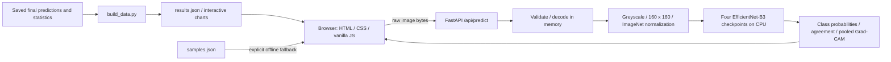

# OrthoTrace delivery — 10 November 2026

OrthoTrace is an X-ray **model evaluation workbench**, backed by a source-controlled orthopaedic joint-recognition study. The models classify Hip, Knee or Shoulder. They do not detect fractures, diagnose disease or identify implants.

## Implemented changes

- Replaced the report-like home page with a product landing page: input-to-insight workflow, checkpoint preview, evidence comparison, clear calls to action and responsive cards. The preview is generated from actual sample probabilities, not invented statistics.
- Added a cream/ink/lime design across all 16 pages, including the workbench; see FRONTEND_DELIVERY.md for the final reference-informed redesign. Kept existing charts, tables, research pages, downloads and study caveats.
- Made sample selection run real inference when the API is online. Offline mode still uses explicitly labelled saved outputs. Uploaded files never use saved predictions.
- Added a specimen-library loading error. Shortened the deliberate report animation delay.
- Limited incoming request bodies while streaming, validated Content-Length, prevented static access to backend source/checkpoints, expired rate-limit entries, moved inference off the async event loop and serialized shared Grad-CAM model access.
- Moved OpenAPI to `/api/openapi.json` so API documentation remains usable behind the backend-file guard.
- Fixed the website data generator's obsolete `E:/ML3` path. Added a separate portable audit without editing frozen training/evaluation code or overwriting its historical audit.
- Added Windows setup/start scripts and service regression tests.

## Run from the supplied workspace

```powershell
Set-Location 'D:\ML Project'
.\start.ps1
```

Open http://localhost:8000. The environment created during this work is `.venv`. The launcher binds only to loopback and requires no credentials or database. Stop with Ctrl+C.

Fresh environment setup:

```powershell
Set-Location 'D:\ML Project'
.\setup.ps1
.\start.ps1
```

The existing `site/api/requirements.txt` retains the original torch 2.4.1 / torchvision 0.19.1 recipe. This session used preinstalled torch **2.15.0+cu132**, torchvision **0.29.2+cu132**, numpy **2.4.6**, Pillow from the existing Python installation, OpenCV **4.10.0**, FastAPI **0.162.2** and Uvicorn **0.54.0**. All nine stored sample predictions matched on this newer runtime. A clean installation of the original recipe was not repeated; do not confuse the two environments. `site/qa/runtime-versions.json` records the tested versions.

The top-level `ML3/requirements.txt` is a historical research environment record, not the demo installation file: it includes a Python version as a pip requirement and CUDA-specific pins. Do not use it for website setup.

## Architecture



- `site/build_site.py` generates the 16 HTML pages; `reference_home.html.template` is the active landing-page source. `assets/css/reference.css` is the final visual layer after the retained structural styles.
- `assets/js/demo.js` checks health, handles file/sample selection and renders reports. `robust.js`, `home-results.js` and `charts.js` render saved study results. GSAP/Lenis remain vendored and reduced-motion support remains available.
- `site/api/app.py` serves public pages and exposes health, model info, prediction and API documentation routes. It limits images to 12 MB and 30 prediction requests/minute/IP per process. There is no login, persistent database, upload store, cloud API or API key.
- `site/api/infer.py` loads four local checkpoints lazily: pooled; without FracAtlas; without Kaggle hip-implant source K; without UCI shoulder-implant source U. All use the same three-class preprocessing and CPU execution.
- The research pipeline remains separate: dataset manifests and grouped splits → development experiments → locally hashed freeze → one-time test evaluation → saved predictions → clustered bootstrap/statistics → figures/manuscript. The demo consumes these outputs and does not retrain or reopen the sealed evaluation pipeline.
- `scratch_meta/ref/aiimaging-main` is historical reference material; it is not the active frontend or backend. `report/` and earlier models are historical project stages and remain intact.

## Actual verification

| Check | Outcome | Evidence |
|---|---|---|
| Generated website static audit | Passed | `site/qa/static-results.txt` |
| Browser layout | All 16 pages at 375, 768 and 1280 px: no page overflow or completed broken images; mobile robustness overflow fixed | `site/qa/browser-results.json` |
| Browser interactions | Live sample 5 report, source-controlled switch and dimension-baseline selector verified | observed browser session; home screenshot in `site/qa/home-preview.jpg` |
| Nine live specimen predictions | All labels matched, maximum probability difference 0.00000 | `site/qa/api-results.txt` |
| Grad-CAM and stored=false | Returned for all nine samples | same API log |
| Image cases | PNG, colour-warning, tiny input, unsupported GIF, 4000×3000 image checked | same API log |
| Service regression | 10 tests passed | `site/qa/service-verified.txt` |
| Incoming body without length | 13 MB rejected with 413 in TestClient | regression suite |
| Backend file boundaries | Source, model registry and checkpoint URLs return 404 | regression suite |
| Checkpoint integrity | 29 research checkpoints match supplied SHA-256 registry; four demo weights match demo registry | `site/qa/saved-results-audit.json`, service tests |
| Saved-result verification | All 438 summary balanced accuracies independently recomputed; maximum absolute difference 2.22e-16 | saved-results audit |
| Manifest and splits | Freeze hash matches; 657 target test rows; no group spans splits | saved-results audit |
| Predictions | No duplicate keys, no label mismatches, complete test coverage | saved-results audit |

The older live API test accepts a closed connection for the oversize-body case; the separate regression test explicitly asserts HTTP 413. The portable audit verifies saved evidence, not clinical validity, training provenance beyond the stored files, or causal hypotheses. Browser findings and limitations are recorded in `site/qa/browser-results.json`.

## Deployment, scalability and cost

The existing Dockerfile and DEPLOY.md describe container deployment; a Docker build and public deployment were not performed in this session. The local service is ready for demonstration, not a production clinical workload. Four checkpoint files occupy approximately 173 MB on disk. CPU inference needs no paid external API. Hosting cost depends on memory, request volume and provider; no monthly cost or throughput figure was measured.

Shared inference is serialized because Grad-CAM mutates hooks/gradients. Multiple workers multiply model memory and each has a separate rate limiter. A scalable service would need bounded admission/queueing, per-user limits, process-wide request governance, observability, and load testing. CPU latency, memory peaks and concurrency capacity have not been benchmarked. Static pages can be hosted separately, but uploads then require a reachable inference endpoint. User feedback and industry adoption have not been collected.

## Remaining work and evidence needed

1. Department report template, required citation style and institutional similarity threshold are missing. The existing manuscript is a research paper, not proof that a department record format is satisfied.
2. Each student must supply real contributions, dates, evidence and lessons learned. Team names in an unused helper do not establish contribution or authorship.
3. The 94 provisional FracAtlas knee labels need real clinician review. The blinded packet exists; no simulated review is represented as real evidence.
4. Some references are abstract-only and several recent entries are preprints. The thematic matrix records these limits; it is not a claim that 15 recent journal/conference papers have all been fully reviewed.
5. Confirm data/image rights, authors/affiliations, ethics, funding and conflict declarations before external release. AV-DDH and some collected-image licences remain unresolved.
6. Historical training scripts and manifests retain `E:/ML3` paths. They were deliberately preserved to avoid changing frozen code. A full portable retraining migration would need a separately versioned protocol and data-path mapping. No training, test unsealing, clinician consensus or new clinical validation was performed.
7. Clean original-runtime installation, Docker deployment, load/performance testing and real user testing remain unverified.

See `TEAM_CHECKLIST.md`, `DEMO_AND_VIVA.md` and `LITERATURE_MATRIX.md` for presentation and submission preparation.
